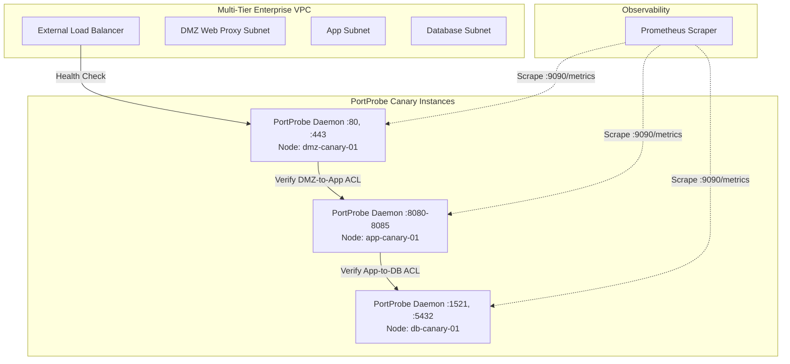

# PortProbe Deployment Architecture Guide

**Document Reference:** `PORTPROBE-DOC-DEP-01`  
**Document Version:** `2.0.0`  
**Classification:** Enterprise Deployment Specification  
**Status:** Official Release  
**Last Updated:** November 2026  

---

## 1. Enterprise Deployment Topologies

PortProbe can be deployed in three standard enterprise topologies depending on the verification goal:

### Topology 1: On-Demand Diagnostic Probe (Ephemeral)
Used during active firewall cutovers or infrastructure provisioning. An engineer starts PortProbe interactively via CLI or an automation script (Ansible, Terraform), conducts reachability tests, and immediately tears down the listener.

### Topology 2: Long-Running Dedicated Connectivity Canary (systemd)
Deployed as a persistent background daemon on designated infrastructure canary hosts. Continually verifies cross-VPC, hybrid-cloud, and multi-region routing paths, while emitting Prometheus metrics to Grafana dashboards.

### Topology 3: Containerized Microservice Pod (Kubernetes / OCI)
Packaged as a lightweight container deployed into Kubernetes clusters or container hosts to validate ingress controllers, network policies (Calico, Cilium), and service mesh egress gateways.

---

## 2. High Availability & Redundancy

Because PortProbe is an authoritative connectivity probe rather than a stateful database or transactional server:
- Deploy independent PortProbe canary instances across each Availability Zone (AZ) or redundant data center rack.
- Front multiple PortProbe instances with a network load balancer (NLB) to test both physical path reachability and load-balancing distribution algorithms simultaneously.
- Configuration is stateless; instances do not share session state, enabling linear scaling.
