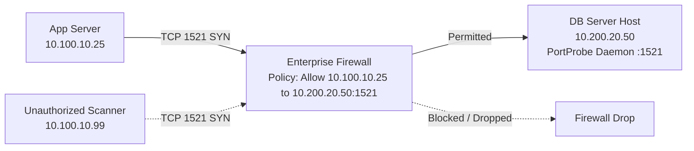

# Real-World Scenario: Firewall Rule Validation

**Document Reference:** `PORTPROBE-DOC-EXM-01`  
**Document Version:** `2.0.0`  
**Classification:** Enterprise Scenario Manual  
**Status:** Official Release  
**Last Updated:** November 2026  

---

## 1. Business Context & Objective

**Business Problem**: A banking application requires establishing a new database connection between the Application Tier (`10.100.10.25`) in the Application VPC and an Oracle Database Cluster (`10.200.20.50`) in the Core Data Center across a Next-Generation Firewall (NGFW). The network security team has opened TCP port `1521`, but the Oracle Database software is not yet installed on the server. The project timeline is tight, and waiting for the database installation to verify connectivity risks delaying production go-live.

**Objective**: Verify bidirectional TCP connectivity across the firewall and validate that only authorized client IPs can reach the target port before installing the database.

---

## 2. Infrastructure Topology



---

## 3. Configuration & Execution

### Step 1: Start PortProbe on the Target Database Server (`10.200.20.50`)
We start PortProbe listening on `1521`, restricting ingress strictly to the App Server IP (`10.100.10.25/32`) and enabling structured JSON logging:

```bash
portprobe \
  --bind 10.200.20.50 \
  --port 1521 \
  --allow-cidr "10.100.10.25/32" \
  --silent-reject true \
  --log-format json
```

### Step 2: Validate Reachability from the Authorized App Server (`10.100.10.25`)
On the application server, execute the native client health check:

```bash
portprobe --health-check --bind 10.200.20.50 --port 1521
```

**Expected Result (Success)**:
```text
PortProbe healthcheck SUCCESS: 10.200.20.50:1521 is reachable
```
*(Process exit code: `0`)*

### Step 3: Validate Firewall Policy Enforcement from an Unauthorized Host (`10.100.10.99`)
From an unauthorized subnet or host, attempt to probe the port:

```bash
portprobe --health-check --bind 10.200.20.50 --port 1521
```

**Expected Result (Rejection / Drop)**:
```text
PortProbe healthcheck FAILURE: Connection reset by peer (os error 104)
```
*(Process exit code: `1`)*

---

## 4. Log Analysis & Audit Evidence

On the database server, PortProbe emits structured JSON audit logs verifying the test:

```json
{"timestamp":"2026-11-20T18:30:10+05:30","level":"INFO","fields":{"message":"Connection accepted from 10.100.10.25:48920"}}
{"timestamp":"2026-11-20T18:30:10+05:30","level":"INFO","fields":{"message":"Success response sent to 10.100.10.25:48920"}}
{"timestamp":"2026-11-20T18:30:15+05:30","level":"DEBUG","fields":{"message":"Connection rejected by CIDR filter: 10.100.10.99 is outside allowed subnets. Client: 10.100.10.99:51220"}}
```

This output provides conclusive audit proof for network engineering and compliance teams that the firewall rule is functioning correctly before application deployment begins.
