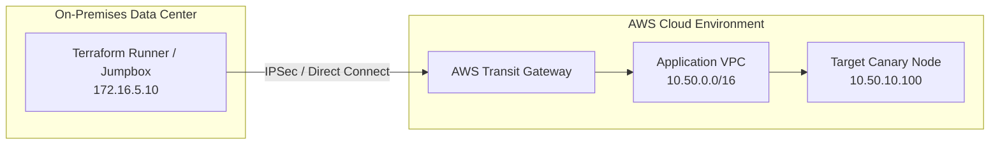

# Real-World Scenario: Infrastructure Deployment Validation

**Document Reference:** `PORTPROBE-DOC-EXM-03`  
**Document Version:** `2.0.0`  
**Classification:** Enterprise Scenario Manual  
**Status:** Official Release  
**Last Updated:** November 2026  

---

## 1. Business Context & Objective

**Business Problem**: A Cloud Platform team provisions a complex hybrid environment via Terraform, creating VPC peering connections, transit gateways (TGW), and direct connects between an on-premises data center and an AWS cloud environment. The platform team must validate that all required microservice ports are open across the network before handing the environment over to development teams.

**Objective**: Execute multi-port PortProbe listeners across microservice port ranges (`8080-8085`, `9000-9002`, `443`) and execute automated end-to-end reachability checks.

---

## 2. Infrastructure Topology



---

## 3. Configuration & Execution

### Step 1: Start Multi-Port PortProbe on Cloud Target (`10.50.10.100`)
```bash
portprobe \
  --bind 0.0.0.0 \
  --ports "443,8080-8085,9000-9002" \
  --allow-cidr "172.16.0.0/12,10.0.0.0/8" \
  --log-format json
```
PortProbe starts up and binds all 10 ports simultaneously.

### Step 2: Automated Verification Script on On-Premises Host
Execute an automated verification script testing all provisioned ports:

```bash
#!/usr/bin/env bash
TARGET_HOST="10.50.10.100"
PORTS=(443 8080 8081 8082 8083 8084 8085 9000 9001 9002)

echo "Starting PortProbe Infrastructure Validation..."
FAILED=0

for port in "${PORTS[@]}"; do
    if portprobe --health-check --bind "$TARGET_HOST" --port "$port"; then
        echo "PORT $port: REACHABLE [PASS]"
    else
        echo "PORT $port: UNREACHABLE [FAIL]" >&2
        FAILED=$((FAILED + 1))
    fi
done

if [ $FAILED -eq 0 ]; then
    echo "SUCCESS: All 10 microservice ports verified across Transit Gateway."
    exit 0
else
    echo "ERROR: $FAILED port(s) failed verification." >&2
    exit 1
fi
```

### Expected Output:
```text
Starting PortProbe Infrastructure Validation...
PortProbe healthcheck SUCCESS: 10.50.10.100:443 is reachable
PORT 443: REACHABLE [PASS]
PortProbe healthcheck SUCCESS: 10.50.10.100:8080 is reachable
PORT 8080: REACHABLE [PASS]
...
PortProbe healthcheck SUCCESS: 10.50.10.100:9002 is reachable
PORT 9002: REACHABLE [PASS]
SUCCESS: All 10 microservice ports verified across Transit Gateway.
```
*(Exit code: 0)*
