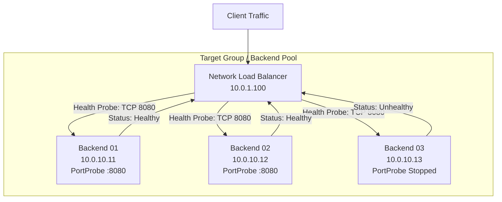

# Real-World Scenario: Load Balancer Backend Verification

**Document Reference:** `PORTPROBE-DOC-EXM-02`  
**Document Version:** `2.0.0`  
**Classification:** Enterprise Scenario Manual  
**Status:** Official Release  
**Last Updated:** November 2026  

---

## 1. Business Context & Objective

**Business Problem**: An SRE team is configuring a high-throughput AWS Network Load Balancer (NLB) or F5 BIG-IP appliance to distribute traffic across a pool of backend API gateway servers. The team must verify:
1. That the load balancer correctly detects healthy and unhealthy backends via TCP and HTTP `/healthz` health checks.
2. That load balancer health checks do not leak connection slots or exhaust backend server resources.

**Objective**: Configure PortProbe instances as lightweight mock backend nodes to validate load balancer probing behavior without running complete microservice containers.

---

## 2. Infrastructure Topology



---

## 3. Configuration & Execution

### Step 1: Deploy PortProbe on Backend Nodes 01 & 02
Configure PortProbe with anti-Slowloris default reclamation (`hold_open = false`) and an administrative HTTP listener for HTTP-based load balancers:

```bash
portprobe \
  --bind 0.0.0.0 \
  --port 8080 \
  --admin-port 9090 \
  --max-connections 500 \
  --max-rate 100 \
  --log-format json
```

### Step 2: Configure Load Balancer Health Check
- **For Layer 4 TCP Load Balancers (AWS NLB, HAProxy TCP mode)**:
  - Protocol: `TCP`
  - Port: `8080`
  - Interval: `5 seconds`
  - Healthy Threshold: `2`
- **For Layer 7 HTTP Load Balancers (AWS ALB, F5 BIG-IP HTTP monitor)**:
  - Protocol: `HTTP`
  - Port: `9090`
  - Path: `/healthz`
  - HTTP Method: `GET` or `HEAD`
  - Expected Response Code: `200`

### Step 3: Validate Load Balancer Target Health
Observe the load balancer management console:
- Backend 01 (`10.0.10.11`): **HEALTHY** (Receives `200 OK` or completes TCP handshake).
- Backend 02 (`10.0.10.12`): **HEALTHY**.
- Backend 03 (`10.0.10.13`): **UNHEALTHY** (Connection refused).

Traffic sent to the VIP `10.0.1.100:8080` is successfully distributed across Backend 01 and Backend 02, confirming load balancing routing before application deployment.
