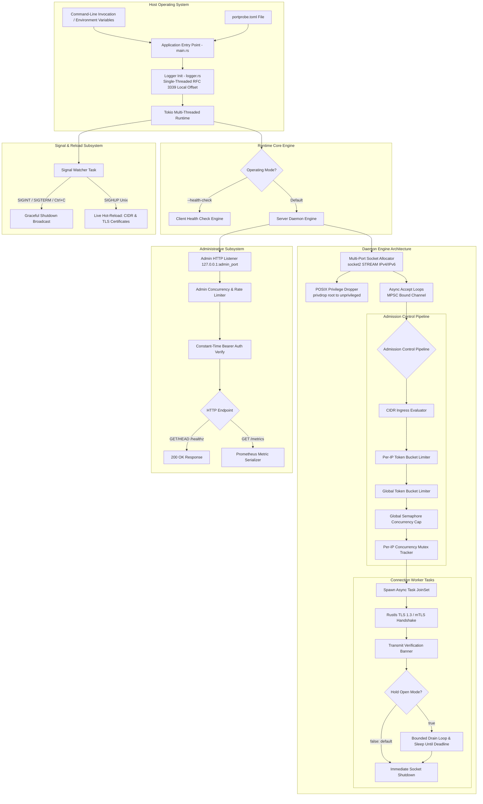
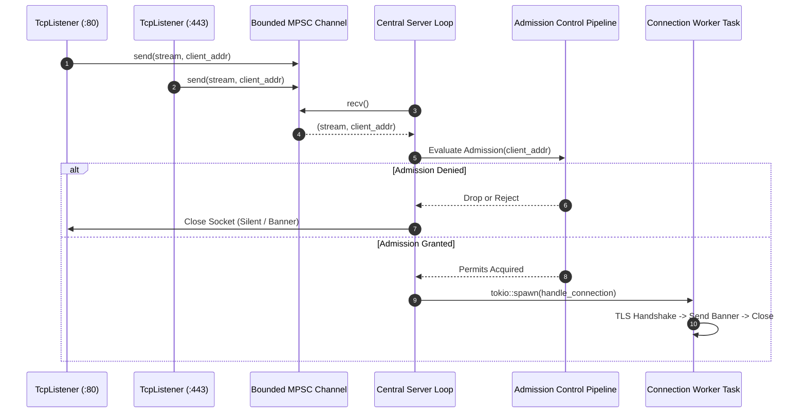
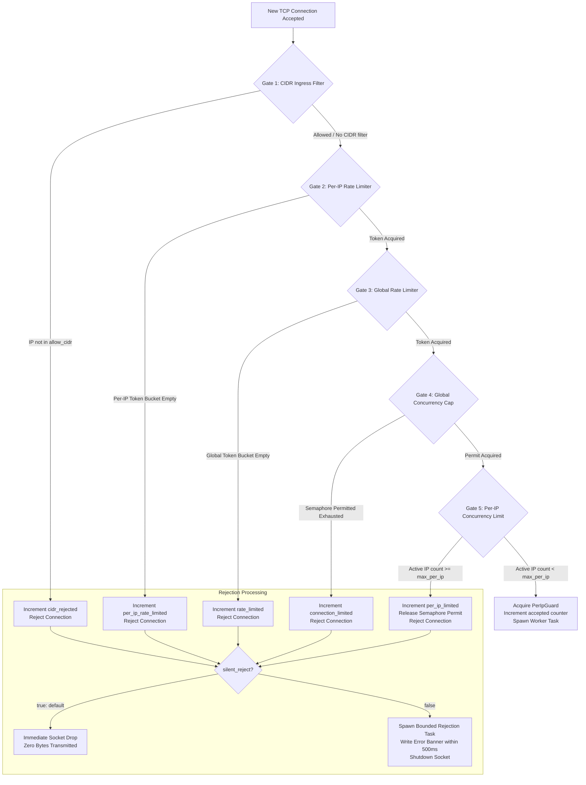
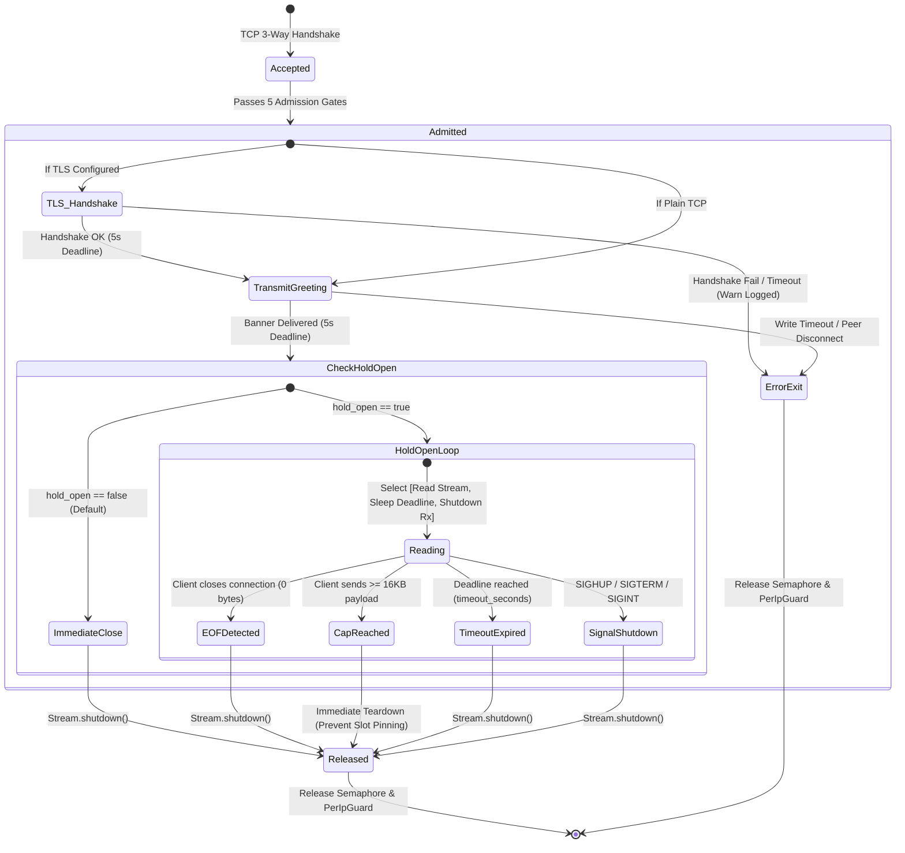
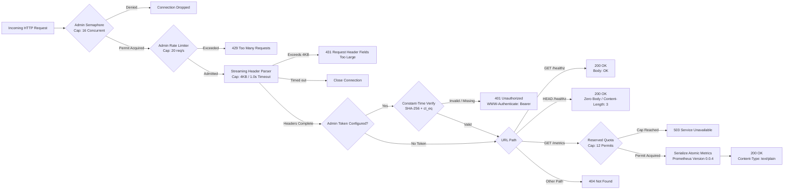
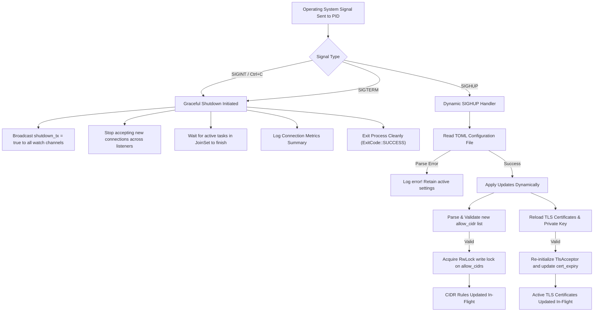

# PortProbe Product Architecture & Technical Design

**Document Reference:** `PORTPROBE-DOC-ARC-02`  
**Document Version:** `2.0.0`  
**Classification:** Enterprise Systems Architecture Specification  
**Status:** Official Release  
**Last Updated:** November 2026  

---

## 1. High-Level System Architecture

PortProbe is designed as an asynchronous, non-blocking network verification system built on the **Tokio** asynchronous runtime and the **Clap** command-line interface framework. Its architecture strictly decouples admission control, transport negotiation, session handling, and administrative observability.



---

## 2. Component Architecture & Module Responsibilities

The codebase is organized into four core modules, each maintaining strict separation of concerns:

```
src/
├── main.rs      <- Application orchestration, CLI entry, runtime bootstrap, signal management
├── cli.rs       <- Configuration parsing, range expansion, file permissions, input validation
├── server.rs    <- TCP listeners, rate limiters, TLS engine, admin HTTP server, client probe
└── logger.rs    <- Tracing subscriber, format selection (Text/JSON), RFC 3339 timezone capture
```

### Module Breakdown:

| Module | Primary Structs & Types | Functional Responsibility |
| :--- | :--- | :--- |
| `src/main.rs` | `main()`, `async_main(args)` | Orchestrates single-threaded logger initialization, configuration file loading, default resolution, runtime initialization, health probe branching, privilege dropping execution, and server loop kickoff. |
| `src/cli.rs` | `Cli`, `ConfigFile`, `Cidr`, `LogFormat` | Implements Clap derive parser; validates timeouts (1–3600s), global concurrency (1–10,000), per-IP concurrency (1–1,000), global rates (1–1,000 req/s), and per-IP rates (1–1,000 req/s); parses CIDR subnets (IPv4, IPv6, IPv4-mapped IPv6); resolves multi-port ranges (`8080-8085`); enforces POSIX file permission checks (`0600`/`0400`) on secrets. |
| `src/server.rs` | `ServerParams`, `ServerContext`, `TokenBucket`, `PerIpRateLimiter`, `Metrics`, `ConnectionStream` | Manages multi-port `socket2` socket configuration (`SO_REUSEADDR` hardening on Windows); executes admission control pipeline; implements Rustls TLS 1.3 / mTLS transport; manages administrative HTTP `/metrics` and `/healthz` endpoints; processes SIGHUP configuration reload; executes client health check probes. |
| `src/logger.rs` | `init_logger(format)`, `LogFormat` | Safely determines local UTC timezone offset in single-threaded context; configures `tracing-subscriber` with `EnvFilter` (`RUST_LOG`); formats records as compact terminal text or SIEM-ready JSON Lines. |

---

## 3. Asynchronous Execution & Concurrency Model

PortProbe leverages Tokio's multi-threaded work-stealing runtime (`rt-multi-thread`).

### 3.1 Socket Ingestion Architecture
To handle multi-port listening across up to 50 distinct ports without thread starvation:
1. Sockets are opened via `socket2::Socket`, configured for non-blocking I/O, bound to the interface, and converted into asynchronous `tokio::net::TcpListener` instances.
2. For each listening socket, an independent, lightweight Tokio task is spawned that continuously calls `listener.accept()`.
3. Accepted raw `(TcpStream, SocketAddr)` pairs are pushed into a bounded Tokio MPSC channel (`tokio::sync::mpsc::channel`) sized to `max_connections`.
4. The central server event loop consumes from this MPSC channel, feeding new connections into the sequential admission control pipeline.



---

## 4. Admission Control Pipeline Deep Dive

Every incoming TCP connection must pass through five rigorous admission gates before any worker task is allocated:



### Detailed Gate Mechanics:

1. **Gate 1: CIDR Ingress Filter**:
   - Compares client IP against configured subnets (`allow_cidr`).
   - Supports IPv4 subnets, IPv6 subnets, single host IPs, and dual-stack IPv4-mapped IPv6 (`::ffff:192.168.1.1`).
   - Evaluation is executed under an asynchronous read lock (`tokio::sync::RwLock`), allowing zero-downtime hot-reloads on SIGHUP.
2. **Gate 2: Per-IP Token Bucket Rate Limiter**:
   - Enforces a dedicated token bucket for each remote IP (default: 5 tokens/second).
   - **IPv6 Subnet Aggregation**: To prevent attackers from evading per-IP limits by rotating IPv6 host addresses, IPv6 addresses are aggregated to their `/64` routing prefix.
   - **Throttled Hash-Map Eviction**: Cleanup is executed at most once every 10 seconds, retaining only buckets refreshed within 60 seconds. A hard cap of 5,000 buckets prevents memory exhaustion.
3. **Gate 3: Global Token Bucket Rate Limiter**:
   - Enforces smooth global connection throughput (default: 20 tokens/second, max 1,000).
   - Computes sub-millisecond micro-tokens based on `Instant::now()` elapsed time, preventing burst starvation.
4. **Gate 4: Global Semaphore Concurrency Cap**:
   - Uses `Arc<tokio::sync::Semaphore>` initialized with `max_connections` (default: 100, max 10,000).
   - Acquired permits are owned (`try_acquire_owned()`) and moved into the connection task, guaranteeing automatic release upon task termination.
5. **Gate 5: Per-IP Concurrency Counter**:
   - Mutex-protected `HashMap<IpAddr, usize>`.
   - Tracks active sessions per IP against `max_connections_per_ip` (default: 10).
   - Wrapped in an RAII `PerIpGuard` struct whose `Drop` implementation safely decrements and removes the entry even if a task panics.

---

## 5. TCP Connection Lifecycle & Anti-Slowloris Architecture

Once admitted, the connection lifecycle depends on whether `--hold-open` is enabled:



### 5.1 Default One-Shot Mode (`hold_open = false`)
In default mode, PortProbe transmits `PORTPROBE: TCP CONNECTION SUCCESSFUL\n` and **immediately initiates socket shutdown (`stream.shutdown().await`)**. This prevents "Slowloris" attacks where malicious clients hold TCP sessions open indefinitely to starve connection pools.

### 5.2 Hold-Open Diagnostic Mode (`hold_open = true`)
When engineers need to verify persistent TCP connectivity or firewall idle-timeout tracking:
- The connection remains open until `timeout_seconds` (default: 15s) expires.
- PortProbe reads from the socket to detect client-initiated disconnects immediately (freeing resources).
- **Payload Draining Cap**: If an unexpected client streams data to the listener, PortProbe caps consumption at 16 KB (`MAX_HOLD_OPEN_DRAIN_BYTES`) and immediately closes the session, mitigating socket pinning.

---

## 6. Administrative HTTP Subsystem & Telemetry Architecture

When `--admin-port` is configured, PortProbe spins up an independent, hardened administrative HTTP server listening exclusively on `127.0.0.1:<admin-port>`.



### Administrative Hardening Features:
1. **Isolated Concurrency Limits**: The administrative listener utilizes an independent semaphore (`admin_semaphore`) permitting 16 concurrent connections, with 4 permits permanently reserved for `/healthz` checks to ensure monitoring probes never fail due to heavy `/metrics` scraping.
2. **Slowloris Header Protection**: Request headers are buffered streaming up to a strict 4,096-byte limit with a 1.0-second read deadline. Header flooding triggers `HTTP 431 Request Header Fields Too Large`.
3. **Timing-Attack Proof Authentication**: Authorization Bearer tokens are validated using constant-time cryptographic verification (`ring::digest::SHA256` hashing + `subtle::ConstantTimeEq`), completely eliminating timing side-channel leaks.

---

## 7. Transport Layer Security (TLS 1.3 / mTLS) Engine

PortProbe embeds the pure-Rust `rustls` engine (`tokio-rustls`), avoiding OpenSSL C-dependencies and known C-library vulnerabilities.

### 7.1 Protocol Version Enforcement
PortProbe defaults to modern, secure protocols: TLS 1.3 and TLS 1.2. When `--tls-min-version 1.3` is specified, the TLS builder strictly configures `&[&tokio_rustls::rustls::version::TLS13]`, completely disabling TLS 1.2 to meet banking and regulatory standards (RBI Cyber Security Framework, PCI-DSS v4.0).

### 7.2 Mutual TLS (mTLS) Client Verification
When `--tls-client-ca` is provided:
- Incoming client certificates are validated against the trusted CA bundle using `WebPkiClientVerifier`.
- Clients failing to provide a trusted certificate are rejected at the TLS handshake phase before any application data is processed.

### 7.3 Automated X.509 Certificate Expiration Tracking
Upon certificate loading and during live SIGHUP reloading, PortProbe inspects the raw DER bytes of the primary certificate, parses the ASN.1 `Validity.notAfter` timestamp, and stores the expiration time as UTC epoch seconds in an atomic gauge (`tls_cert_expiry`).
- Exposes `portprobe_tls_cert_expiry_timestamp_seconds` via Prometheus `/metrics`.
- Emits a prominent system `warn!` log if the active certificate expires in less than 30 days.

---

## 8. Dynamic Configuration & Signal Architecture (Linux/Unix)

PortProbe listens for operating system signals via `tokio::signal::unix`:



---

## 9. Operating System Resource Management & Performance

### 9.1 Memory Footprint & Zero Allocation Path
- The connection accept path operates with minimal heap allocations.
- Fixed response banners are stored as `&'static [u8]` constants (`RESPONSE`, `FORBIDDEN_RESPONSE`, `RATE_LIMITED_RESPONSE`).
- Idle memory footprint is ~12 MB RSS. Under 5,000 active concurrent connections, memory remains stable below 35 MB RSS.

### 9.2 File Descriptor Utilization
Each active TCP connection consumes one operating system file descriptor.
- With default `--max-connections 100`, standard OS limits (`ulimit -n 1024`) are sufficient.
- For high-concurrency deployments (`--max-connections 1000` to `10000`), PortProbe documentation mandates raising `LimitNOFILE` to `65535` in the systemd unit.

### 9.3 Platform-Specific Socket Hardening
- **Windows Port Hijack Hardening**: On Windows, default socket behaviors can allow non-administrative users to bind overlapping ports using `SO_REUSEADDR`. PortProbe explicitly invokes `socket.set_reuse_address(false)` on Windows across both IPv4 and IPv6 sockets, mitigating local socket-hijacking attacks.
- **POSIX Privilege Dropping**: On Linux/Unix, when started as root to bind privileged ports (< 1024), PortProbe invokes `drop_privileges` using `privdrop` immediately after successfully binding the sockets, dropping EUID and EGID to the unprivileged account specified via `--user` and `--group`.
