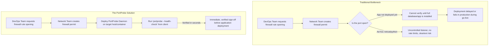
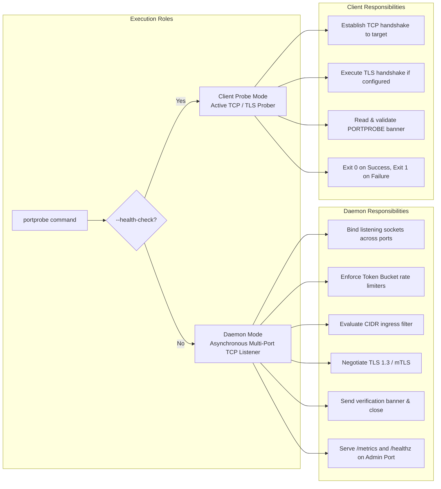

# PortProbe Product Overview

**Document Reference:** `PORTPROBE-DOC-PRD-01`  
**Document Version:** `2.0.0`  
**Classification:** Enterprise Infrastructure Software Specification  
**Status:** Official Release  
**Last Updated:** November 2026  

---

## 1. Executive Summary & Product Introduction

**PortProbe** is an asynchronous, high-concurrency TCP connectivity verification daemon and client probe written in 100% safe Rust. It provides infrastructure engineers, Site Reliability Engineering (SRE) teams, network administrators, and DevOps practitioners with a lightweight, secure, and deterministic utility to validate network reachability, test firewall access control lists (ACLs), verify load balancer health probing, and diagnose network routing paths across distributed hybrid-cloud infrastructure.

Traditionally, verifying that a newly provisioned firewall rule or software-defined network (SDN) security group works required either:
1. Waiting for the complete multi-tier enterprise workload (such as an Oracle/PostgreSQL database, Kafka cluster, or SAP backend) to be fully installed and running.
2. Ad-hoc execution of fragile, insecure workarounds like `nc -l` (Netcat), Python's `http.server`, or Telnet listeners that lack rate limiting, multi-port support, authentication, logging, and security isolation.

PortProbe eliminates this operational friction. By executing as a hardened standalone daemon or an automated client probe, PortProbe allows teams to establish authoritative TCP listeners on demand, verify bidirectional network reachability, and safely teardown or integrate into continuous monitoring without introducing security vulnerabilities or resource exhaustion into the environment.

---

## 2. Problem Statement: Why PortProbe Was Developed

In modern enterprise environments—spanning physical data centers, software-defined perimeters (SDP), Kubernetes clusters, and multi-cloud virtual private clouds (VPCs)—network connectivity provisioning is a multi-team operational bottleneck.

### The Enterprise Challenges Addressed:

1. **The "Chicken-and-Egg" Dependency Dilemma**:
   Application deployment pipelines frequently fail at the final stage because an underlying network route, NAT gateway, or firewall port was incorrectly configured. Infrastructure teams cannot verify connectivity until the application is running, but the application cannot start until its backend dependencies are reachable.
2. **Security Vulnerabilities of Ad-Hoc Utilities**:
   Engineers frequently resort to running `nc -l -p <port>` or `python3 -m http.server <port>`. These utilities:
   - Accept unrestricted incoming payloads, creating potential remote code execution or buffer overflow vectors.
   - Lack concurrency limits, making the host vulnerable to connection starvation.
   - Lack rate limiting, allowing network scanners to consume CPU and file descriptors.
   - Do not support TLS or mutual TLS (mTLS), transmitting plain text across sensitive network segments.
   - Run with elevated permissions without privilege-dropping capabilities.
3. **Load Balancer and Health Probe Verification Gaps**:
   When configuring hardware or cloud load balancers (F5 BIG-IP, AWS ALB/NLB, HAProxy, Envoy), engineers need a deterministic backend target that responds correctly to TCP three-way handshakes, TLS handshakes, or HTTP `/healthz` endpoints without generating application-tier errors.
4. **Automated CI/CD Infrastructure Testing**:
   Terraform and Ansible provisioning scripts require a fast, deterministic tool with standardized exit codes to validate that newly provisioned infrastructure complies with network access policies before releasing workloads.

---

## 3. Product Vision and Core Objectives

PortProbe was designed from the ground up to embody five core architectural principles:

- **Safety & Robustness**: Written strictly in safe Rust (`#![deny(unsafe_code)]`). Zero memory corruption, buffer overflows, or data races.
- **Minimal Resource Footprint**: Asynchronous I/O powered by Tokio, capable of sustaining thousands of concurrent connections while consuming less than 15 MB of resident memory (RSS).
- **Zero Inadvertent Attack Surface**: Rejects arbitrary client payloads. Transmits only a fixed, deterministic verification banner (`PORTPROBE: TCP CONNECTION SUCCESSFUL\n`) and immediately reclaims connection slots.
- **Enterprise Security Compliance**: Built-in TLS 1.3 encryption, mTLS client verification, CIDR ingress filtering, POSIX privilege dropping (`setuid`/`setgid`), and constant-time Bearer token authentication.
- **Observability & Automation**: Structured JSON logging formatted for SIEM ingestion (Splunk, Elastic, Datadog), Prometheus `/metrics` exposition, and automated client health checking with binary exit codes.

---

## 4. Key Capabilities & Functional Matrix

PortProbe provides a rich set of built-in capabilities tailored for enterprise operations:

| Capability Domain | Implemented Features in PortProbe 2.0.0 | Operational Benefit |
| :--- | :--- | :--- |
| **TCP Listener Management** | Multi-port listening (`--ports 80,443,8080-8085`), single port (`--port`), flexible IP binding (`--bind 127.0.0.1` or `0.0.0.0`), dual-stack IPv4/IPv6 support. | Verify up to 50 distinct ports or ranges concurrently across complex microservice port allocations. |
| **Active Client Probing** | Native health check client (`--health-check`), TLS client probe (`--health-check-tls`), SNI hostname verification (`--health-check-domain`), custom CA validation (`--health-check-ca`). | Eliminates dependency on external tools; automated verification in bash scripts and CI/CD pipelines. |
| **Admission Control** | Token-bucket global rate limiting (`--max-rate`), per-source-IP rate limiting (`--max-rate-per-ip`), global connection cap (`--max-connections`), per-source-IP connection cap (`--max-connections-per-ip`). | Protects host operating systems against Denial of Service (DoS), connection starvation, and SYN flood impact. |
| **Network Ingress Filtering** | Zero-overhead CIDR subnet allowlisting (`--allow-cidr "10.0.0.0/8,192.168.1.0/24"`). | Ensures only authorized subnets can verify reachability; drops unauthorized scanners immediately. |
| **Reconnaissance Defense** | Anti-fingerprinting silent rejection (`--silent-reject`). | Drops unauthorized connections immediately at the TCP socket layer without sending error banners to scanners. |
| **Anti-Slowloris Engine** | Immediate connection slot reclamation post-banner (`--hold-open false` default), bounded payload draining (16 KB cap) when hold-open is enabled. | Prevents malicious or misconfigured clients from exhausting server connection pools by holding sockets open. |
| **Transport Security** | Native TLS 1.3 / 1.2 server encryption (`--tls-cert`, `--tls-key`), mutual TLS (`--tls-client-ca`), minimum TLS protocol version enforcement (`--tls-min-version 1.3`). | Enforces regulatory compliance (PCI-DSS, RBI, HIPAA) across encrypted networks without sidecars. |
| **Dynamic Configuration** | Dynamic SIGHUP configuration reload on Linux/Unix systems (`kill -HUP <PID>`). | Hot-reload CIDR subnet rules and TLS certificates without restarting the daemon or dropping active connections. |
| **Metrics & Administration** | Embedded administrative server (`--admin-port`) exposing `/metrics` (Prometheus) and `/healthz` (GET/HEAD), constant-time Bearer token auth (`--admin-token-file`). | Native integration into Prometheus, Datadog, Grafana, and cloud load balancer health checks. |
| **Structured Logging** | Single-line compact text logging or structured JSON Lines (`--log-format json`) with RFC 3339 local timezone timestamps. | Direct, high-speed ingestion into enterprise SIEM log pipelines. |
| **System Hardening** | POSIX privilege dropping (`--user`, `--group`), systemd service sandboxing, Windows socket hijack protection (`set_reuse_address(false)`). | Conforms to CIS Operating System Benchmarks and NIST SP 800-53 controls. |

---

## 5. Architecture & Core Components

PortProbe operates as a self-contained single binary capable of assuming two roles based on command-line flags:

### Daemon Role Responsibilities:
- Binds up to 50 TCP listening sockets concurrently across specified interfaces.
- Manages an admission control pipeline: CIDR evaluation -> Per-IP rate limiting -> Global rate limiting -> Semaphore connection permits -> Per-IP connection counters.
- Conducts TLS 1.3 handshakes using certificates loaded from disk.
- Writes the deterministic greeting response: `PORTPROBE: TCP CONNECTION SUCCESSFUL\n`.
- Manages the administrative HTTP listener on `127.0.0.1:<admin-port>` for health and telemetry scraping.

### Client Probe Role Responsibilities:
- Connects to the destination IP and port with a strict 3-second network timeout.
- Optionally performs a TLS handshake validating the target's certificate chain against a custom CA bundle and expected SNI domain.
- Reads incoming bytes and asserts that the response begins with the exact PortProbe success header.
- Terminates with standard OS exit code `0` on verified reachability, or `1` on timeout, connection refusal, CIDR rejection, or TLS failure.

---

## 6. Target Audience & Stakeholders

PortProbe is built specifically for:

- **Site Reliability Engineers (SREs)**: Fast triage of distributed network outages; validating service mesh and load balancer ingress/egress.
- **DevOps Engineers**: Embedding automated network reachability tests into CI/CD delivery pipelines (Jenkins, GitLab CI, GitHub Actions) and Terraform runbooks.
- **Network Engineers & Administrators**: Proving firewall policy activation, routing changes, and VPC peering reachability before handing over infrastructure to application teams.
- **Security & Compliance Officers**: Ensuring connectivity diagnostics adhere to CIS benchmarks, privilege-dropping requirements, and strict network encryption standards.
- **System Administrators**: Verifying OS-level socket availability, interface bindings, and port conflicts during host commissioning.

---

## 7. Supported Enterprise Use Cases

1. **Firewall & Security Group Validation**: Verify that traffic from an application subnet can traverse next-generation firewalls (Palo Alto, Fortinet, Check Point) or cloud security groups to reach a target database port (e.g., TCP 1521, 3306, 5432).
2. **Load Balancer Health Probe Validation**: Act as a lightweight backend target for AWS NLB, F5 BIG-IP, or HAProxy to verify health check pass/fail behavior before backend workloads are live.
3. **Multi-Port Microservice Staging**: Open a range of ports (e.g., `8080-8090`) to represent microservice listener pools and verify full routing tables in one command.
4. **Automated CI/CD Deployment Gates**: Execute `portprobe --health-check` in deployment scripts to verify that cloud VPC peering, transit gateways, or Kubernetes egress controllers are functional before deploying application containers.
5. **Encrypted Network Segment Verification**: Validate that TLS termination, mutual TLS (mTLS) policies, and custom internal PKI root certificates work end-to-end.
6. **Network Diagnostic Triage**: Differentiate between "firewall dropped packet" (connection timeout), "port not listening" (connection refused), and "firewall rejected packet" (TCP RST).

---

## 8. Comparative Analysis: PortProbe vs. Traditional Utilities

| Feature / Metric | PortProbe 2.0.0 | Netcat (`nc -l`) | Python (`http.server`) | Telnet / Curl |
| :--- | :--- | :--- | :--- | :--- |
| **Language & Runtime** | Safe Rust (Tokio) | C (POSIX) | Python (Interpreted) | C |
| **Memory Footprint** | ~12 MB RSS | ~2 MB RSS | ~35 MB RSS | ~5 MB RSS |
| **Multi-Port / Ranges** | **Yes** (Up to 50 ports) | No (Single port only) | No (Single port only) | Client only |
| **Global Rate Limiting** | **Yes** (Token Bucket) | No (None) | No (None) | N/A |
| **Per-IP Rate Limiting** | **Yes** (Token Bucket) | No (None) | No (None) | N/A |
| **Concurrency Limiting** | **Yes** (Semaphore bounded) | No (Unbounded or 1) | Threaded/Forking | N/A |
| **CIDR Subnet Ingress** | **Yes** (Zero-overhead filter) | No | No | N/A |
| **Silent Reconnaissance Drop** | **Yes** (`--silent-reject`) | No | No | N/A |
| **Built-in TLS 1.3 / mTLS** | **Yes** (Rustls native) | No (Plaintext only) | Requires custom script | TLS client only |
| **Certificate Hot-Reload** | **Yes** (SIGHUP dynamic) | No | No | N/A |
| **POSIX Privilege Dropping** | **Yes** (`--user`/`--group`) | No | No | N/A |
| **SIEM Structured JSON** | **Yes** (`--log-format json`) | No (Unstructured text) | No (HTTP log text) | N/A |
| **Prometheus Telemetry** | **Yes** (Native `/metrics`) | No | No | N/A |
| **Client Probe Mode** | **Yes** (`--health-check`) | Client mode available | Client not built-in | Client only |

---

## 9. Product Limitations and Explicit Non-Goals

To maintain absolute security, reliability, and minimal operational complexity, PortProbe maintains strict design boundaries:

- **Non-Goal: Application Workload Emulation**: PortProbe does NOT emulate complex application-level protocols (such as HTTP/2 REST APIs, GraphQL, SQL protocols, Kafka wire protocol, or gRPC streaming). It responds with a fixed ASCII banner over raw TCP or TLS.
- **Non-Goal: Arbitrary Command Execution**: PortProbe never executes shell commands or processes user-supplied input received over the network.
- **Non-Goal: UDP Probing (Version 2.0.0)**: PortProbe currently supports TCP and TLS over TCP only. UDP reachability testing is slated for a future release.
- **Non-Goal: Windows Service Dispatcher (Native)**: While PortProbe includes a `--service` flag in its CLI interface and runs natively on Windows via console or tools like NSSM, native Windows Service Control Manager (SCM) dispatching is partially implemented and planned for Version 2.1.0.
- **Non-Goal: Kernel-Level SYN Flood Defense**: While PortProbe implements token-bucket admission control, kernel-level SYN flood mitigation remains the responsibility of operating system syncookies and perimeter firewalls.
