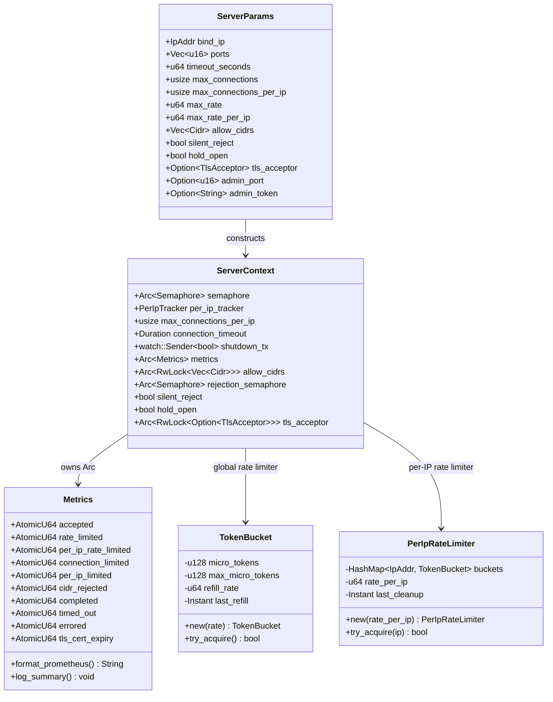
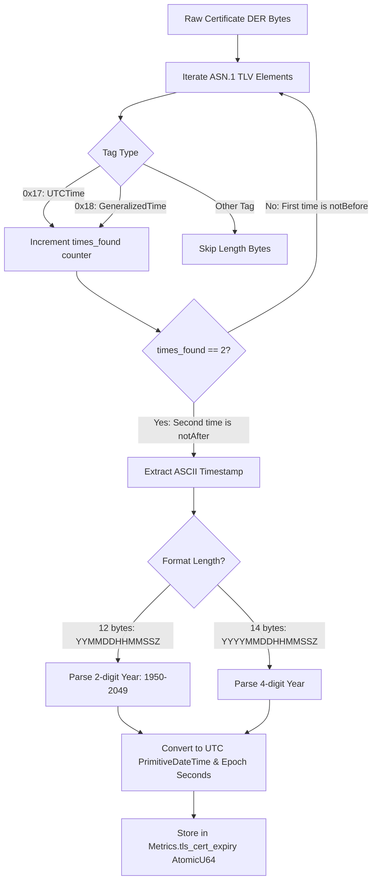

# PortProbe Technical Design & Internal Implementation

**Document Reference:** `PORTPROBE-DOC-TCH-03`  
**Document Version:** `2.0.0`  
**Classification:** Deep-Dive Technical Implementation Manual  
**Status:** Official Release  
**Last Updated:** November 2026  

---

## 1. Internal State & Memory Model

PortProbe is architected to guarantee thread safety, zero data races, and zero memory corruption without relying on a garbage collector or runtime lock contention.

### 1.1 State Ownership Hierarchy



---

## 2. Token Bucket Rate Limiting Algorithm

PortProbe avoids the burst vulnerabilities associated with fixed-window counters (which permit 2x traffic bursts across window boundaries) by implementing an exact continuous-time **Token Bucket Algorithm** computed in micro-tokens.

### 2.1 Micro-Token Mathematics
- Standard token buckets increment discrete integer tokens every second. Under high concurrency, integer division can cause rounding errors and token drift.
- PortProbe defines:
  $$\text{MICRO\_TOKENS\_PER\_TOKEN} = 1,000,000$$
  $$\text{max\_micro\_tokens} = \text{refill\_rate} \times 1,000,000$$
- When an incoming connection arrives at time $t_{\text{now}}$, the elapsed time $\Delta t$ since $t_{\text{last}}$ is computed in nanoseconds:
  $$\text{added\_micro\_tokens} = \frac{\Delta t_{\text{nanos}} \times \text{refill\_rate}}{1000}$$
- If tokens are added:
  $$\text{new\_tokens} = \min(\text{current\_tokens} + \text{added\_tokens}, \text{max\_tokens})$$
- A connection requires exactly $1,000,000$ micro-tokens. If available, $1,000,000$ micro-tokens are subtracted and `try_acquire()` returns `true`; otherwise it returns `false`.

### 2.2 Per-IP Rate Limiting & IPv6 Prefix Aggregation
To prevent an aggressive client from starving the global token bucket:
1. Every client IP is canonicalized (IPv4-mapped IPv6 addresses like `::ffff:192.0.2.1` are mapped directly to `192.0.2.1`).
2. Native IPv6 addresses are masked to their `/64` routing prefix via `rate_limit_key`:
   ```rust
   let segs = v6.segments();
   IpAddr::V6(Ipv6Addr::new(segs[0], segs[1], segs[2], segs[3], 0, 0, 0, 0))
   ```
   This prevents malicious actors from circumventing per-IP rate limiting by cycling through the $2^{64}$ host addresses in their allocated subnet.
3. **Throttled Hash-Map Garbage Collection**:
   - Running map-wide cleanups on every connection creates $O(N)$ CPU spikes.
   - PortProbe checks `Instant::now().duration_since(last_cleanup) >= 10s`.
   - If 10 seconds have elapsed, it retains only buckets active within the last 60 seconds.
   - If the map exceeds 5,000 entries, it evicts fully refilled buckets down to 4,000 entries.

---

## 3. Mutual Exclusion & Poisoning Resilience

A known failure mode in multi-threaded software is mutex poisoning: if a thread panics while holding a standard `std::sync::Mutex`, subsequent threads attempting to acquire the lock will panic on `.unwrap()`, bringing down the entire daemon.

PortProbe eliminates this risk across all synchronized structures:

### 3.1 Per-IP Connection Tracker (`PerIpTracker`)
In `PerIpGuard::drop`:
```rust
let mut counts = self
    .tracker
    .lock()
    .unwrap_or_else(|poisoned| poisoned.into_inner());
```
Even if a connection task panics, the poisoned lock is safely reclaimed via `.into_inner()`, guaranteeing that per-IP connection slots are decremented and never leaked.

### 3.2 Administrative Rate Limiter
In `start_admin_server`:
```rust
let mut rl = admin_rate_limiter
    .lock()
    .unwrap_or_else(|p| p.into_inner());
```
Guarantees administrative endpoints remain accessible even if an internal worker task experiences a panic.

---

## 4. Constant-Time Cryptographic Verification

To mitigate timing side-channel attacks on the administrative endpoint, PortProbe avoids naive string comparisons (`==`). When evaluating the HTTP `Authorization: Bearer <token>` header:

1. Both the candidate token and the expected token are hashed using SHA-256 via `ring::digest::digest`:
   ```rust
   let candidate_digest = digest(&SHA256, candidate.as_bytes());
   let expected_digest = digest(&SHA256, expected.as_bytes());
   ```
2. The fixed-length 32-byte digests are compared in constant time using `subtle::ConstantTimeEq`:
   ```rust
   candidate_digest.as_ref().ct_eq(expected_digest.as_ref()).into()
   ```
This guarantees that token comparison execution time is strictly independent of token length or prefix matches, completely defeating timing analysis.

---

## 5. X.509 Certificate DER / ASN.1 Expiration Parser

Rather than pulling in heavy OpenSSL or X.509 parsing dependencies, PortProbe implements a focused, zero-allocation ASN.1 parser to extract certificate expiration dates directly from the raw DER bytes:



---

## 6. Multi-Port Socket Range Resolver

The CLI range resolver (`resolve_all_ports` in `src/cli.rs`) handles flexible input specifications:
- Discrete values: `80`, `443`.
- Continuous ranges: `8080-8085`.
- Safety guards:
  - Validates ports are between 1 and 65,535.
  - Rejects inverted ranges (e.g., `8085-8080`).
  - Limits any single range span to 100 ports (`(end - start) <= 100`).
  - Deduplicates overlapping ports (`resolved.sort_unstable(); resolved.dedup()`).
  - Hard-caps the total number of bound listening ports to **50 sockets** (`resolved.len() <= 50`) to protect the host against file descriptor exhaustion.

---

## 7. Unified Stream Abstraction (`ConnectionStream`)

To handle plain TCP, TLS server connections, and TLS client health checks uniformly without dynamic dispatch (`dyn`) overhead, PortProbe encapsulates stream types in an enum implementing `tokio::io::AsyncRead` and `tokio::io::AsyncWrite`:

```rust
pub enum ConnectionStream {
    Plain(TcpStream),
    TlsServer(Box<tokio_rustls::server::TlsStream<TcpStream>>),
    TlsClient(Box<tokio_rustls::client::TlsStream<TcpStream>>),
}
```

This guarantees optimal branch prediction and inline polling in the Tokio reactor.
