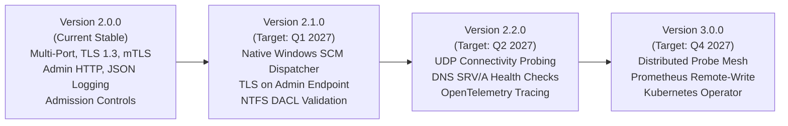

# PortProbe Enterprise Product Roadmap

**Document Reference:** `PORTPROBE-DOC-REL-03`  
**Document Version:** `2.0.0`  
**Classification:** Enterprise Strategic Roadmap  
**Status:** Official Release  
**Last Updated:** November 2026  

---

## 1. Roadmap Evolution & Planned Capabilities

The PortProbe product roadmap outlines planned enhancements across upcoming minor and major releases:

---

## 2. Release Milestones & Feature Breakdown

### Version 2.1.0 (Q1 2027)
- **Native Windows Service Dispatcher**: Integrate `windows-service` crate to link `--service` directly to the Windows Service Control Manager (SCM).
- **TLS on Administrative Endpoint**: Add `--admin-tls` to allow secure remote Prometheus scraping over HTTPS.
- **Windows NTFS DACL Validation**: Native Win32 API checks verifying that secret token files are accessible only by the service owner.

### Version 2.2.0 (Q2 2027)
- **UDP Connectivity Verification**: Support UDP echo/diagnostic listeners and client probing.
- **DNS Resolution Probing**: Active validation of split-horizon DNS, SRV records, and reverse lookups.
- **OpenTelemetry (OTel) Native Tracing**: Export distributed trace spans for connection lifecycle diagnostics.

### Version 3.0.0 (Q4 2027)
- **PortProbe Mesh Coordinator**: Centralized coordination daemon aggregating distributed probe results across multi-cloud VPCs.
- **Kubernetes Custom Resource Definition (CRD) & Operator**: Automate canary probe deployment across Kubernetes clusters.
