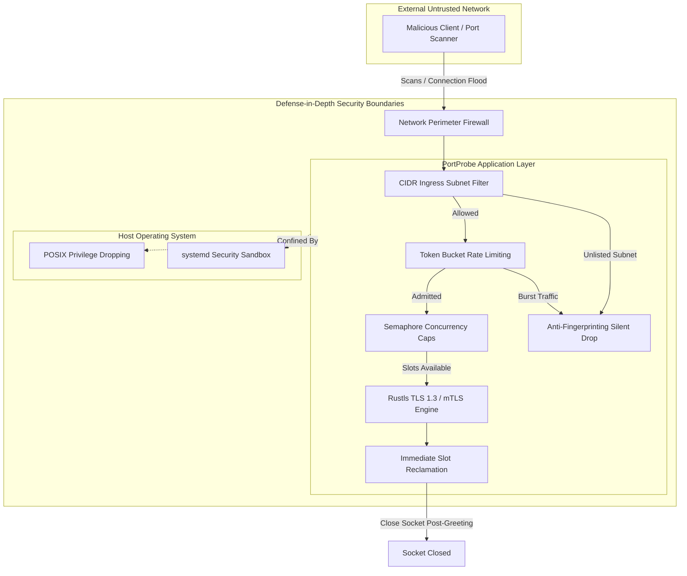

# PortProbe Security Architecture & Compliance Guide

**Document Reference:** `PORTPROBE-DOC-SEC-01`  
**Document Version:** `2.0.0`  
**Classification:** Enterprise Security Specification  
**Status:** Official Release  
**Last Updated:** November 2026  

---

## 1. Security Architecture & Threat Model

PortProbe is engineered to minimize attack surface in enterprise and critical infrastructure environments.

---

## 2. Threat Modeling & Mitigation Analysis

| Threat / Attack Vector | Risk | PortProbe Technical Mitigation | Implementation Verification |
| :--- | :--- | :--- | :--- |
| **Port Scanning Fingerprinting** | Information Disclosure (CWE-200) | `--silent-reject true` immediately closes the TCP socket without transmitting error banners, preventing scanners from detecting the service. | `src/server.rs:1373-1382` |
| **Connection Slot Starvation (DoS)** | Availability (CWE-400) | Token-bucket rate limiting (`--max-rate`, `--max-rate-per-ip`) and global concurrency caps (`--max-connections`). | `src/server.rs:415-533` |
| **Single-IP Monopolization** | Resource Exhaustion (CWE-770) | Dedicated per-source-IP token bucket and concurrency limiters (`--max-connections-per-ip`, `--max-rate-per-ip`). | `src/server.rs:1446-1483` |
| **IPv6 Subnet Rotation Attacks** | Evasion (CWE-407) | Native IPv6 addresses are aggregated to their `/64` routing prefix, preventing attackers from rotating host IPs. | `src/server.rs:468-480` |
| **Slowloris Connection Pinning** | Availability (CWE-400) | Default mode (`--hold-open false`) transmits the banner and closes the socket immediately. In hold-open mode, payload draining is capped at 16 KB. | `src/server.rs:1592-1630` |
| **Buffer Overflow / Memory Corruption** | Memory Safety (CWE-119) | 100% safe Rust (`#![deny(unsafe_code)]`). Zero unsafe pointers, zero manual memory management. | `src/main.rs:7` |
| **Credential Exposure in Process List** | Credential Exposure (CWE-214) | Emits system warning if `--admin-token` is passed on CLI; provides `--admin-token-file` and `PORTPROBE_ADMIN_TOKEN`. | `src/main.rs:136-141` |
| **Timing Side-Channel Attacks** | Timing Analysis (CWE-208) | SHA-256 pre-hashing and constant-time token comparison (`subtle::ConstantTimeEq`) on administrative endpoints. | `src/server.rs:147-157` |
| **Windows Socket Hijacking** | Socket Security (CWE-605) | Disables `SO_REUSEADDR` on Windows sockets (`socket.set_reuse_address(false)`), mitigating local port takeover. | `src/server.rs:1057-1061` |
| **Privilege Escalation** | Privilege Management (CWE-250) | Drops root privileges post-socket-bind to an unprivileged user (`--user`, `--group`). Aborts if root drop fails. | `src/server.rs:306-343` |

---

## 3. Cryptographic and Transport Security

1. **Rustls Pure-Rust Cryptography**: PortProbe uses `rustls` instead of OpenSSL, eliminating memory-unsafe C-code and Heartbleed-class vulnerabilities.
2. **Protocol Version Enforcement**: By default, supports TLS 1.3 and TLS 1.2. Specifying `--tls-min-version 1.3` strictly disables TLS 1.2, enforcing modern cryptographic suites (AES-GCM, ChaCha20-Poly1305).
3. **Mutual TLS (mTLS)**: Validates client certificates against a trusted CA bundle (`--tls-client-ca`) before accepting any connection.
4. **Certificate Expiration Alerting**: Automatically extracts ASN.1 validity timestamps and exposes `portprobe_tls_cert_expiry_timestamp_seconds` via Prometheus, emitting a warning if a certificate expires within 30 days.

---

## 4. Compliance Mapping Matrix

| Standard / Framework | Control Reference | PortProbe Compliance Mechanism |
| :--- | :--- | :--- |
| **NIST SP 800-53 Rev. 5** | **AC-3 Access Enforcement** | Ingress filtering via `--allow-cidr` and constant-time Bearer token authentication. |
| **NIST SP 800-53 Rev. 5** | **AC-6 Least Privilege** | POSIX privilege dropping (`--user`, `--group`) and non-root container user (`UID 10001`). |
| **NIST SP 800-53 Rev. 5** | **SC-8 Transmission Confidentiality** | Native TLS 1.3 encryption with mTLS client certificate verification. |
| **NIST SP 800-53 Rev. 5** | **SC-5 Denial of Service Protection** | Token bucket rate limiting, global/per-IP concurrency caps, and Slowloris prevention. |
| **NIST SP 800-53 Rev. 5** | **AU-2 Event Logging** | Structured JSON Lines logging with RFC 3339 timestamps for SIEM auditing. |
| **CIS Linux Benchmark** | **5.4 Secure System Configuration** | systemd unit with `ProtectSystem=strict`, `NoNewPrivileges=true`, `PrivateTmp=true`. |
| **PCI-DSS v4.0** | **Requirement 4: Strong Cryptography** | Enforces minimum TLS 1.2 / TLS 1.3 and rejects weak ciphers. |
| **RBI Cyber Security Guidelines** | **Network Security & Access Controls** | Enforces strict port authorization, silent reconnaissance drops, and constant-time token comparison. |

---

## 5. Security Boundaries and Limitations

To maintain compliance and integrity, engineers must understand PortProbe's operational boundaries:
- **No TCP User Authentication**: PortProbe does not implement user-level authentication (usernames/passwords) on standard diagnostic ports. The diagnostic banner is sent to any admitted client. Access control is enforced via CIDR filtering, rate limits, and mTLS.
- **Admin Authentication**: Authentication is enforced exclusively on the administrative HTTP server (`--admin-port`) via Bearer tokens.
- **Kernel-Level Defense**: PortProbe provides application-level admission control. It does not replace kernel-level firewall state tables or hardware DDoS mitigation appliances.
