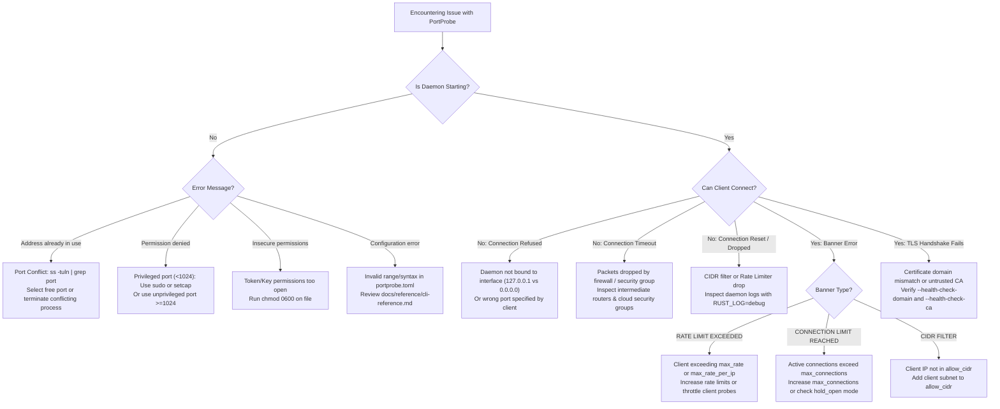

# PortProbe Troubleshooting Guide

**Document Reference:** `PORTPROBE-DOC-TRB-01`  
**Document Version:** `2.0.0`  
**Classification:** Operational Troubleshooting Manual  
**Status:** Official Release  
**Last Updated:** November 2026  

---

## 1. Troubleshooting Decision Flowchart

Use this flowchart to quickly diagnose and remediate connectivity or daemon issues:



---

## 2. Detailed Diagnostic Scenarios & Resolutions

### Scenario 1: Daemon Fails to Start - "Address already in use"
- **Symptoms**: PortProbe exits with code 1; log shows:  
  `Failed to accept connection on 0.0.0.0:8080: Address already in use (os error 98)`
- **Possible Causes**: Another application (e.g., Nginx, Tomcat, another PortProbe instance) is already bound to that port.
- **Diagnostic Steps**:
  ```bash
  # Linux
  sudo ss -tulpn | grep 8080
  sudo lsof -i :8080

  # Windows (PowerShell)
  Get-NetTCPConnection -LocalPort 8080
  ```
- **Resolution**: Stop the competing process, or configure PortProbe to listen on an alternative port (e.g., `--port 8081`).

---

### Scenario 2: Client Receives "Connection Refused"
- **Symptoms**: Client running `nc -vz <server-ip> 8080` or `portprobe --health-check` reports:  
  `Connection refused (os error 111)`
- **Possible Causes**:
  1. PortProbe is bound to `127.0.0.1` (localhost only) instead of `0.0.0.0` or the network interface IP.
  2. PortProbe daemon is not running.
- **Diagnostic Steps**:
  ```bash
  # On the server, verify the exact listening address:
  ss -tuln | grep 8080
  # If it displays 127.0.0.1:8080, remote machines cannot connect.
  ```
- **Resolution**: Restart PortProbe with `--bind 0.0.0.0` or the specific host IP.

---

### Scenario 3: Client Receives "Connection Timeout"
- **Symptoms**: Client hangs for 30–60 seconds, then reports connection timeout.
- **Possible Causes**:
  1. A network firewall (iptables, firewalld, AWS Security Group, Palo Alto firewall) is silently dropping packets (`DROP` action).
  2. Routing table is missing a return route back to the client subnet.
- **Diagnostic Steps**:
  ```bash
  # Test with traceroute / mtr
  mtr -T -P 8080 <server-ip>

  # On the server, check if SYN packets arrive using tcpdump:
  sudo tcpdump -ni any port 8080
  ```
- **Resolution**: Update intermediate firewall access rules or routing table entries.

---

### Scenario 4: Unauthorized Connections Dropped Silently
- **Symptoms**: Client connects, but the connection closes immediately without receiving any banner or data.
- **Possible Causes**:
  1. PortProbe has `--silent-reject true` enabled (default), and the client IP is not included in `--allow-cidr`.
  2. The client exceeded `--max-rate-per-ip` or `--max-connections-per-ip`.
- **Diagnostic Steps**:
  Check daemon logs with debug verbosity (`RUST_LOG=debug portprobe ...`):
  ```text
  2026-11-20T18:20:00+05:30 DEBUG Connection rejected by CIDR filter: 192.168.10.15 is outside allowed subnets. Client: 192.168.10.15:52110
  ```
- **Resolution**: Add the client IP or subnet to `allow_cidr`, or adjust rate limits.

---

### Scenario 5: Insecure File Permissions Error
- **Symptoms**: Startup fails with:  
  `Configuration error: Insecure permissions on /etc/portprobe/admin_token.secret: 644. Must not be accessible by group or others (enforce 0600 or 0400)`
- **Possible Causes**: The administrative token or TLS private key file has group or world read permissions.
- **Resolution**:
  ```bash
  chmod 0600 /etc/portprobe/admin_token.secret
  chmod 0600 /etc/portprobe/certs/server.key
  ```
