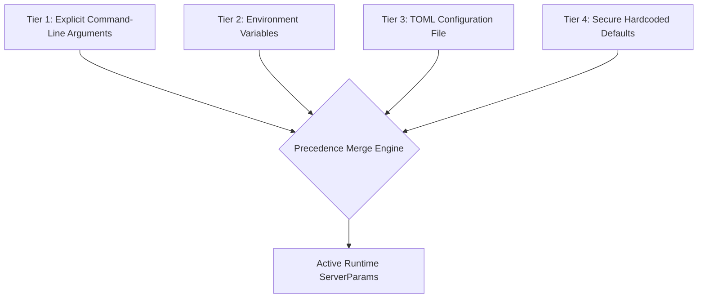

# Configuration Architecture & Management

**Document Reference:** `PORTPROBE-DOC-UG-06`  
**Document Version:** `2.0.0`  
**Classification:** Comprehensive User Manual  
**Status:** Official Release  
**Last Updated:** November 2026  

---

## 1. Configuration Precedence Model

PortProbe adheres to the standard three-tier enterprise configuration hierarchy:



### Precedence Rules:
1. **Command-Line Arguments**: Highest precedence. Any flag explicitly passed on the command line (e.g., `--bind 127.0.0.1`) strictly overrides all file and environment values.
2. **Environment Variables**: Read automatically via Clap's `env` attribute (e.g., `PORTPROBE_BIND`).
3. **Configuration File**: Specified via `-c` / `--config` or `PORTPROBE_CONFIG`. Unspecified CLI options are populated from the TOML file.
4. **Hardcoded Secure Defaults**: Unconfigured parameters are resolved to secure enterprise defaults (`bind = 127.0.0.1`, `silent_reject = true`, `hold_open = false`, `timeout = 15s`).

---

## 2. TOML Configuration File Schema

PortProbe supports a declarative TOML configuration file (typically installed at `/etc/portprobe/portprobe.toml`).

```toml
# PortProbe Enterprise Configuration File

# Primary TCP port to listen on
port = 8080

# Additional discrete ports or port ranges
ports = ["8081", "8082", "8090-8095"]

# Bind IP address (127.0.0.1 for localhost, 0.0.0.0 for all interfaces)
bind = "0.0.0.0"

# Connection lifetime in seconds
timeout = 15

# Concurrency and Rate Limits
max_connections = 1000
max_connections_per_ip = 25
max_rate = 50
max_rate_per_ip = 10

# CIDR Subnet Ingress Allowlist
allow_cidr = [
    "10.0.0.0/8",
    "172.16.0.0/12",
    "192.168.0.0/16",
    "127.0.0.1/32"
]

# Security controls
silent_reject = true
hold_open = false
log_format = "json"

# Administrative Endpoint (127.0.0.1)
admin_port = 9090
admin_token_file = "/etc/portprobe/admin_token.secret"

# TLS Transport Encryption
tls_cert = "/etc/portprobe/certs/server.crt"
tls_key = "/etc/portprobe/certs/server.key"
tls_min_version = "1.3"
# tls_client_ca = "/etc/portprobe/certs/ca-bundle.crt"

# Linux Privilege Dropping
user = "portprobe"
group = "portprobe"
```

---

## 3. Secret Management & File Permissions

PortProbe enforces strict security on cryptographic keys and bearer authentication tokens:

### Enforcing Permissions on POSIX Systems:
When `--admin-token-file` or `--tls-key` is specified, PortProbe's `verify_file_permissions` inspects file metadata.
- If permissions allow access by group or others (`mode & 0o077 != 0`), startup **strictly fails** with:
  ```text
  Configuration error: Insecure permissions on /etc/portprobe/admin_token.secret: 644. 
  Must not be accessible by group or others (enforce 0600 or 0400)
  ```
- **Remediation**:
  ```bash
  chmod 0600 /etc/portprobe/admin_token.secret
  chmod 0600 /etc/portprobe/certs/server.key
  chown portprobe:portprobe /etc/portprobe/admin_token.secret
  ```
