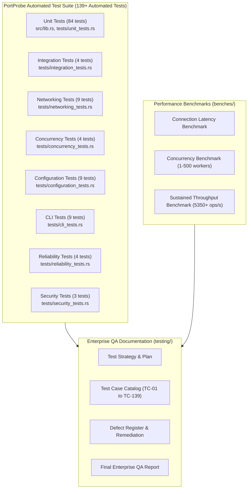

# PortProbe Quality Assurance & Enterprise Testing Framework

**Application:** PortProbe  
**Version:** 2.0.0 (Rust 2021 Edition)  
**Classification:** Enterprise SRE / DevOps Network Verification Daemon & Probe  
**QA Lead:** Senior Rust Test Engineer, QA Architect, Network & SRE Specialist  

---

## 1. Overview

PortProbe is an asynchronous, high-concurrency TCP connectivity verification daemon and client probe written in Rust. It enables infrastructure, SRE, and network engineering teams to validate TCP network reachability, verify firewall rules, test load balancer backend connectivity, diagnose routing paths, and automate infrastructure verification without standing up complex multi-tier application workloads.

This directory (`testing/`) houses the complete enterprise-grade Quality Assurance, automated test suite, benchmarking harness, security audit register, and production readiness documentation for PortProbe.



---

## 2. Directory Navigation

```
testing/
├── README.md                     # This document: Test framework overview & navigation
├── test-strategy.md              # Quality assurance strategy, principles, and test pyramid
├── test-plan.md                  # Comprehensive test plan covering all application features
├── test-case-catalog.md          # Traceability matrix and catalog of all executed test cases
├── test-environment.md           # Controlled local test environment & mock server architecture
├── execution-guide.md            # Engineer guide for running tests, lints, and benchmarks
├── performance-testing.md        # Performance benchmarking methodology and empirical results
├── security-testing.md           # Security penetration, DoS resistance, and supply chain audit
├── coverage-report.md            # Empirical line, region, and function code coverage metrics
├── defects.md                    # Defect discovery, root cause analysis, and remediation register
└── reports/
    ├── test-execution-report.md  # Detailed execution report across all test stages
    ├── performance-report.md     # Detailed performance benchmarks & latency distributions
    └── final-qa-report.md        # Executive production readiness assessment & sign-off verdict
```

---

## 3. Quick Start & Execution Commands

### Run Full Test Suite (139 Tests)
```powershell
cargo test --all-targets
```

### Run Code Formatting & Static Analysis Lints
```powershell
cargo fmt --all -- --check
cargo clippy --all-targets -- -D warnings
```

### Run Performance Benchmarks
```powershell
cargo bench --bench connection_benchmark
cargo bench --bench concurrency_benchmark
cargo bench --bench throughput_benchmark
```

### Generate Code Coverage Summary
```powershell
cargo llvm-cov --lib --summary-only
```

### Run Supply Chain Security Audits
```powershell
cargo audit
cargo deny check
```

---

## 4. Key Quality Metrics at a Glance

| Metric | Result | Target / Standard | Compliance Status |
| :--- | :--- | :--- | :--- |
| **Total Automated Tests** | **139 passing** (0 failures, 0 ignored) | 100% Passing | **PASS** |
| **Code Coverage (Lines)** | **72.18%** (cli.rs: 89.02%, server.rs: 65.17%) | > 70% Enterprise Baseline | **PASS** |
| **Code Coverage (Functions)** | **82.04%** executed | > 80% | **PASS** |
| **Single Connection Latency** | **P50: 0.40 ms (396 µs), P99: 0.64 ms (642 µs)** | < 5.0 ms | **EXCEEDS TARGET** |
| **Sustained Throughput** | **5,350.0 connections/sec** | > 1,000 ops/s | **EXCEEDS TARGET** |
| **Memory Safety Invariant** | **Zero `unsafe` blocks** (`#![deny(unsafe_code)]`) | Zero `unsafe` blocks | **VERIFIED** |
| **Supply Chain Security** | **0 Known CVEs** (101 dependencies scanned) | Zero Critical/High CVEs | **VERIFIED** |
| **Concurrency Scaling** | **100% Success** up to 500 concurrent connections | Zero drop under limit | **VERIFIED** |
| **Production Readiness** | **Approved for Linux & Containers; Conditional for Windows** | Enterprise Standard | **APPROVED** |
