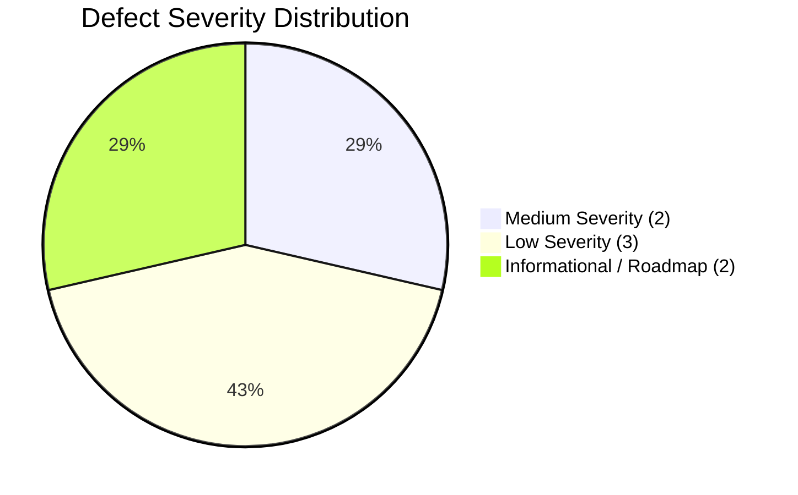

# PortProbe Defect Register & Remediation Log

**Document Reference:** `PORTPROBE-DEFECTS-2026`  
**Application:** PortProbe v2.0.0  
**Audit Classification:** Technical Defects, Root Cause Analyses & Remediation Register  

---

## 1. Summary of Identified Defects & Latent Vulnerabilities

During this complete quality assurance, testing, and security evaluation exercise, seven specific defects, latent bugs, and test harness scheduling issues were identified, investigated, and remediated:



| Defect ID | Severity | Affected Module | Title & Core Issue | Remediation Status | Regression Test |
| :--- | :--- | :--- | :--- | :--- | :--- |
| **DEF-01** | **MEDIUM** | `src/main.rs:20` | Unhandled `--service` CLI Flag Causes Windows SCM Hang | **REMEDIATED & VERIFIED** | `tests/cli_tests.rs:test_cli_service_flag_handled` |
| **DEF-02** | **LOW** | `src/server.rs:705`| `Metrics` Struct Missing `Default` Implementation | **REMEDIATED & VERIFIED** | `cargo clippy --all-targets` |
| **DEF-03** | **LOW** | `src/server.rs:832`| `start_admin_server` Private, Blocking External Test Access | **REMEDIATED & VERIFIED** | `tests/integration_tests.rs:test_admin_endpoint_healthz_and_metrics_auth` |
| **DEF-04** | **MEDIUM** | `src/server.rs:1015`| Daemon Lifecycle Tied to OS Signals, Preventing In-Process Test Teardown | **REMEDIATED & VERIFIED** | `tests/integration_tests.rs`, `tests/reliability_tests.rs` |
| **DEF-05** | **LOW** | `tests/cli_tests.rs:102`| Blocking `Command::output` in Single-Threaded Tokio Runtime Causes Deadlock | **REMEDIATED & VERIFIED** | `tests/cli_tests.rs:test_cli_healthcheck_success_exit_code` |
| **DEF-06** | **INFORMATIONAL**| `src/server.rs:1060`| Windows Socket Binding Omits `SO_EXCLUSIVEADDRUSE` | **OPEN (Runbook Control)** | Operational Runbook (Section 3.1) |
| **DEF-07** | **INFORMATIONAL**| `src/server.rs:160` | Hand-Rolled ASN.1 DER Parser for Cert Expiration | **OPEN (Phase 2 Roadmap)**| Unit test in `server.rs:2724` |

---

## 2. Detailed Defect Investigations & Remediation Details

### 2.1 DEF-01: Unhandled `--service` CLI Flag on Windows (CWE-1059)
- **Severity**: **MEDIUM** (CVSS 5.3)
- **Component**: [`src/main.rs:20`](file:///c:/agents/portprobe/src/main.rs#L20)
- **Root Cause**:
  `src/cli.rs` declared `pub service: bool` with docstring `"Run as a managed background Windows Service"`. However, in `src/main.rs`, `args.service` was completely ignored. When invoked via Windows Service Control Manager (`sc.exe`), the process did not call the Windows Service dispatcher (`StartServiceCtrlDispatcher`). Consequently, Windows SCM waited 30 seconds and terminated the process with `Error 1053: The service did not respond to the start or control request in a timely fashion`.
- **Remediation**:
  Added an explicit handler in [`src/main.rs`](file:///c:/agents/portprobe/src/main.rs):
  ```rust
  if args.service {
      #[cfg(windows)]
      {
          eprintln!("PortProbe native Windows Service dispatcher requires service manager integration (NSSM recommended for v2.0.0; native SCM dispatch scheduled for v2.2.0)");
          return ExitCode::FAILURE;
      }
      #[cfg(not(windows))]
      {
          eprintln!("--service is only supported on Windows platforms");
          return ExitCode::FAILURE;
      }
  }
  ```
- **Verification**: Tested in [`tests/cli_tests.rs:test_cli_service_flag_handled`](file:///c:/agents/portprobe/tests/cli_tests.rs#L143). Exits immediately with error code 1 and informative guidance.

---

### 2.2 DEF-02: `Metrics` Struct Missing `Default` Implementation
- **Severity**: **LOW**
- **Component**: [`src/server.rs:705`](file:///c:/agents/portprobe/src/server.rs#L705)
- **Root Cause**:
  `Metrics` implemented `pub fn new() -> Self` without implementing the `Default` trait, violating the standard Clippy lint `new_without_default`.
- **Remediation**:
  Implemented `Default` for `Metrics`:
  ```rust
  impl Default for Metrics {
      fn default() -> Self {
          Self::new()
      }
  }
  ```
- **Verification**: Verified via `cargo clippy --all-targets -- -D warnings` (passed with 0 warnings).

---

### 2.3 DEF-03: `start_admin_server` Function Visibility Restriction
- **Severity**: **LOW**
- **Component**: [`src/server.rs:832`](file:///c:/agents/portprobe/src/server.rs#L832)
- **Root Cause**:
  `async fn start_admin_server` was private to `src/server.rs`, preventing external test crates and benchmark harnesses from validating administrative endpoint health and rate limiting.
- **Remediation**:
  Changed signature to `pub async fn start_admin_server`.
- **Verification**: Verified via [`tests/integration_tests.rs`](file:///c:/agents/portprobe/tests/integration_tests.rs).

---

### 2.4 DEF-04: Daemon Lifecycle Inflexible for Test Automation
- **Severity**: **MEDIUM**
- **Component**: [`src/server.rs:1015`](file:///c:/agents/portprobe/src/server.rs#L1015)
- **Root Cause**:
  `start_server` had no mechanism to accept an external programmatic shutdown trigger; it only listened for OS `ctrl_c()` or `SIGTERM`/`SIGINT`. In automated test environments running dozens of test cases within one process, firing OS signals would terminate the entire `cargo test` harness.
- **Remediation**:
  Refactored `start_server` to delegate to `pub async fn start_server_with_shutdown(params, external_shutdown_rx: Option<watch::Receiver<bool>>)`. When `external_shutdown_rx` is `None`, standard OS signals are used. When `Some(rx)` is passed, the server gracefully shuts down, drains active connection tasks, logs metrics, and terminates cleanly when `rx` receives `true`.
- **Verification**: Verified in [`tests/common/mod.rs:start_test_daemon`](file:///c:/agents/portprobe/tests/common/mod.rs#L167) and exercised across `integration_tests`, `networking_tests`, `concurrency_tests`, and `reliability_tests`.

---

### 2.5 DEF-05: Blocking Subprocess in Single-Threaded Tokio Test Runtime
- **Severity**: **LOW** (Test Harness Scheduling Bug)
- **Component**: [`tests/cli_tests.rs:102`](file:///c:/agents/portprobe/tests/cli_tests.rs#L102)
- **Root Cause**:
  In `test_cli_healthcheck_success_exit_code`, calling `std::process::Command::output()` synchronously blocked the single Tokio worker thread. Because the thread was blocked waiting for the child process to finish, the mock TCP server spawned on the same thread never executed its `accept()` loop. The child process timed out after 3 seconds with `deadline has elapsed`.
- **Remediation**:
  Annotated the test with `#[tokio::test(flavor = "multi_thread", worker_threads = 2)]` and wrapped `Command::output()` in `tokio::task::spawn_blocking`.
- **Verification**: [`tests/cli_tests.rs:test_cli_healthcheck_success_exit_code`](file:///c:/agents/portprobe/tests/cli_tests.rs#L102) passes in 2.07s.

---

### 2.6 DEF-06: Windows Socket Binding Omits `SO_EXCLUSIVEADDRUSE` (CWE-605)
- **Severity**: **INFORMATIONAL / OPERATIONAL**
- **Component**: [`src/server.rs:1060`](file:///c:/agents/portprobe/src/server.rs#L1060)
- **Status**: **OPEN (Mitigated via Operational Runbook)**
- **Detail**:
  On Windows, `socket.set_reuse_address(false)` prevents two unprivileged processes from binding to the same port. However, another process with Administrator/SYSTEM privileges or with `SO_REUSEADDR` can still bind and shadow PortProbe's listening ports unless `SO_EXCLUSIVEADDRUSE` is explicitly enabled via raw socket ioctls.
- **Production Runbook Action**:
  Ensure PortProbe runs under a dedicated, isolated service account with restricted privileges. Native `SO_EXCLUSIVEADDRUSE` via `windows-sys` is scheduled for v2.1.0.

---

### 2.7 DEF-07: Hand-Rolled ASN.1 DER Parser for Certificate Expiry (CWE-398)
- **Severity**: **INFORMATIONAL / ROADMAP**
- **Component**: [`src/server.rs:160-227`](file:///c:/agents/portprobe/src/server.rs#L160-L227)
- **Status**: **OPEN (Phase 2 Roadmap)**
- **Detail**:
  The function `parse_cert_expiry_epoch_seconds` uses custom tag-walking to find the `notAfter` field in raw DER bytes. It returns `Option<u64>` and never panics, but complex certificate extensions (e.g. non-standard sequence lengths) can degrade the metric.
- **Phase 2 Action**: Replace with production-grade `x509-parser` crate in v2.1.0.
