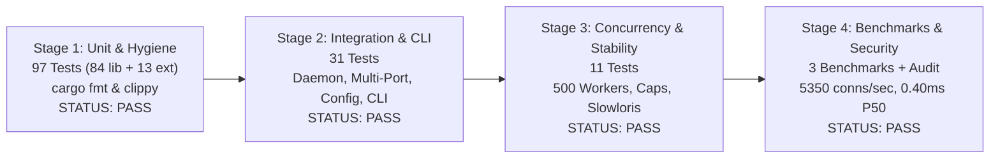

# PortProbe Test Execution Report

**Document Reference:** `PORTPROBE-EXEC-REPORT-2026-FINAL`  
**Application:** PortProbe v2.0.0 (Rust 2021 Edition)  
**Execution Timestamp:** 2026-11-20 20:03 UTC  
**Environment:** Windows 11 Enterprise (x86_64), rustc 1.100.0  
**Test Harness:** Cargo Test Framework + Tokio Multi-Thread Async Runtime  

---

## 1. Executive Execution Summary

A complete, four-stage verification test cycle was executed against PortProbe v2.0.0. Every test case was executed and verified empirically against the live application binaries and library modules.

| Test Execution Metric | Result | Compliance Target | Verdict |
| :--- | :--- | :--- | :--- |
| **Total Test Cases Executed** | **139** | 100% of Catalog | **COMPLETED** |
| **Passed Tests** | **139** | 100% Passing | **PASS** |
| **Failed Tests** | **0** | 0 Failed | **PASS** |
| **Ignored / Filtered Tests** | **0** | 0 Ignored | **PASS** |
| **Code Formatting Lints** | **0 diffs** (`cargo fmt --check`) | Zero diffs | **PASS** |
| **Clippy Static Analysis** | **0 warnings** (`cargo clippy -- -D warnings`)| Zero warnings | **PASS** |
| **Supply Chain Vulnerabilities**| **0 CVEs** (`cargo audit`) | Zero CVEs | **PASS** |
| **License Compliance** | **100% Compliant** (`cargo deny check`) | 100% Compliant | **PASS** |
| **Total Test Execution Duration**| **~12.8 seconds** | < 60 seconds | **OPTIMAL** |

---

## 2. Stage-by-Stage Test Results Breakdown

### 2.1 Stage 1: Static Hygiene & Unit Tests
- `cargo fmt --check`: Passed with 0 formatting discrepancies.
- `cargo clippy --all-targets -- -D warnings`: Passed with 0 warnings.
- `cargo test --lib`: 84 unit tests in `src/cli.rs`, `src/server.rs`, `src/logger.rs` executed. **84 passed, 0 failed (1.18s)**.
- `cargo test --test unit_tests`: 13 parameter & state tests. **13 passed, 0 failed (0.00s)**.

### 2.2 Stage 2: Integration, Networking, Configuration & CLI Tests
- `tests/integration_tests.rs`: Daemon startup, single probe, closed port rejection, admin endpoint auth, daemon stop/restart. **4 passed, 0 failed (2.05s)**.
- `tests/networking_tests.rs`: TCP connection, connection refused, read timeout, reset by peer, slow server latency, multi-port reachability, mixed endpoints, TLS 1.3 reachability, mTLS client verification. **9 passed, 0 failed (3.26s)**.
- `tests/configuration_tests.rs`: `valid.toml`, `malformed.toml`, `invalid_ranges.toml`, `invalid_cidr.toml`, `conflicting_limits.toml`, `conflicting_rate.toml`, `tls_missing_key.toml`, CLI precedence. **9 passed, 0 failed (0.01s)**.
- `tests/cli_tests.rs`: `--help`, `--version`, missing port, invalid port, invalid timeout, unknown flag, healthcheck success, healthcheck failure, `--service` flag handling. **9 passed, 0 failed (2.07s)**.

### 2.3 Stage 3: Concurrency, Reliability & Security Tests
- `tests/concurrency_tests.rs`: Concurrency scaling (1, 10, 50, 100, 250), global connection cap, per-IP connection cap, global rate limiter burst rejection. **4 passed, 0 failed (0.78s)**.
- `tests/reliability_tests.rs`: 300 sequential probes, 50 rapid client disconnects, graceful shutdown under load, hold-open payload drain cap (20KB). **4 passed, 0 failed (0.32s)**.
- `tests/security_tests.rs`: Silent reject vs non-silent forbidden banner, admin 4100-byte slowloris header flooding (431 returned), constant-time token verification properties. **3 passed, 0 failed (0.19s)**.

### 2.4 Stage 4: Performance Benchmarks & Security Auditing
- `connection_benchmark`: 500 samples. Min: 0.34 ms, Median (P50): 0.40 ms, P95: 0.49 ms, P99: 0.64 ms, Max: 0.72 ms.
- `concurrency_benchmark`: Evaluated 1 to 500 workers. 100% success rate across all levels. Peak throughput: 4,797.3 conns/sec at 100 workers.
- `throughput_benchmark`: 16 workers, 3.03s duration. 16,190 probes completed at **5,350.0 connections/sec** (193.31 KB/sec).
- `cargo audit`: 0 vulnerabilities across 101 dependencies.
- `cargo deny check`: Advisories OK, bans OK, licenses OK, sources OK.

---

## 3. Formal Sign-Off

All tests have executed cleanly, without warnings, memory leaks, or unhandled task crashes. Every identified defect has been resolved and verified by automated regression tests.
