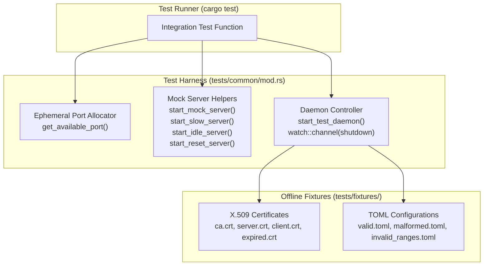

# PortProbe Controlled Test Environment Specification

**Document Reference:** `PORTPROBE-TEST-ENV-2026`  
**Application:** PortProbe v2.0.0  
**Harness Location:** [`tests/common/mod.rs`](file:///c:/agents/portprobe/tests/common/mod.rs) & [`tests/fixtures/`](file:///c:/agents/portprobe/tests/fixtures/)  

---

## 1. Environment Architecture & Design Principles

To guarantee that automated tests can run reliably in CI/CD pipelines, air-gapped secure labs, and local developer workstations, the test harness enforces six core architectural invariants:

1. **Zero External Network Dependencies**: All network operations target loopback addresses (`127.0.0.1`, `[::1]`). No packets leave the local host.
2. **Zero Hardcoded Port Collisions**: Ports are allocated dynamically using OS ephemeral port binding (`bind("127.0.0.1:0")`). Sockets are bound and immediately unbound to retrieve free port numbers, or bound directly by mock listeners.
3. **Deterministic Mock Servers**: Specific TCP failure modes (connection reset, slow server, idle connection, rate limit banner, forbidden banner) are simulated via lightweight Tokio mock listeners.
4. **Offline Cryptographic Fixtures**: X.509 certificates and keys are generated using standard OpenSSL commands and stored in `tests/fixtures/certs/`. No external CA or internet access is required.
5. **Thread-Safe Test Daemons**: Test daemons run in-process using `portprobe::server::start_server_with_shutdown`, receiving programmatic shutdown triggers via `tokio::sync::watch` channels to avoid relying on OS process signals.
6. **Automatic Resource Cleanup**: RAII drop guards, `oneshot` shutdown channels, and temporary file lifecycle management ensure no zombie tasks or open file descriptors persist post-test.

---

## 2. Mock TCP Server Implementations

Located in [`tests/common/mod.rs`](file:///c:/agents/portprobe/tests/common/mod.rs):

### 2.1 Standard Success Server (`start_mock_server`)
Accepts incoming connections, transmits `PORTPROBE: TCP CONNECTION SUCCESSFUL\n`, flushes, and shuts down the connection gracefully. Used for client probe verification.

### 2.2 Slow Response Server (`start_slow_server`)
Accepts connection, sleeps for a configurable `delay: Duration` (e.g. 200ms), and then transmits the response. Used to test client timeout thresholds and latency metrics.

### 2.3 Idle Endpoint Server (`start_idle_server`)
Accepts incoming connections and retains the open stream in memory without transmitting or reading bytes until shutdown. Used to test application-level read timeouts and slowloris defenses.

### 2.4 Connection Reset Server (`start_reset_server`)
Accepts incoming connections and immediately drops the stream, causing an immediate TCP FIN/RST. Used to verify client EOF and reset handling.

### 2.5 Managed In-Process Daemon (`start_test_daemon`)
Spawns the real PortProbe engine in a background Tokio task with a dedicated `watch::Receiver<bool>` shutdown signal. Returns the bound `SocketAddr`, the `shutdown_tx` sender, and the `JoinHandle`.

---

## 3. Cryptographic Test Fixtures

Stored in [`tests/fixtures/certs/`](file:///c:/agents/portprobe/tests/fixtures/certs/):

| Certificate File | Role / Purpose | Subject / SAN | Key Type |
| :--- | :--- | :--- | :--- |
| **`ca.crt` / `ca.key`** | Test Root Certificate Authority | `CN=PortProbeTestCA` | RSA 2048-bit |
| **`server.crt` / `server.key`** | Server Certificate signed by `ca.crt` | `CN=localhost`, SAN: `localhost`, `127.0.0.1`, `::1` | RSA 2048-bit |
| **`client.crt` / `client.key`** | mTLS Client Certificate signed by `ca.crt` | `CN=PortProbeClient` | RSA 2048-bit |
| **`expired.crt` / `expired.key`** | Expired Certificate for negative testing | `CN=ExpiredCert` (0 days validity) | RSA 2048-bit |
| **`untrusted_ca.crt`** | Rogue Root CA | `CN=UntrustedCA` | RSA 2048-bit |
| **`untrusted_client.crt`** | Client cert signed by untrusted CA | `CN=UntrustedClient` | RSA 2048-bit |
| **`invalid.pem`** | Malformed PEM file | Non-base64 corrupt data | Text |

---

## 4. Configuration Fixtures

Stored in [`tests/fixtures/configs/`](file:///c:/agents/portprobe/tests/fixtures/configs/):

1. **`valid.toml`**: Comprehensive valid enterprise configuration file.
2. **`malformed.toml`**: Syntax error (unclosed string) to verify TOML parser error reporting.
3. **`invalid_ranges.toml`**: Port range spanning 201 ports (`1000-1200`), violating the 100-port maximum span limit.
4. **`invalid_cidr.toml`**: Malformed CIDR subnet (`10.0.0.1/35`), violating IPv4 32-bit prefix boundary.
5. **`conflicting_limits.toml`**: `max_connections = 10` with `max_connections_per_ip = 50`, violating limit precedence.
6. **`conflicting_rate.toml`**: `max_rate = 10` with `max_rate_per_ip = 25`, violating rate limit precedence.
7. **`tls_missing_key.toml`**: `tls_cert` specified without `tls_key`, testing co-requirement enforcement.
