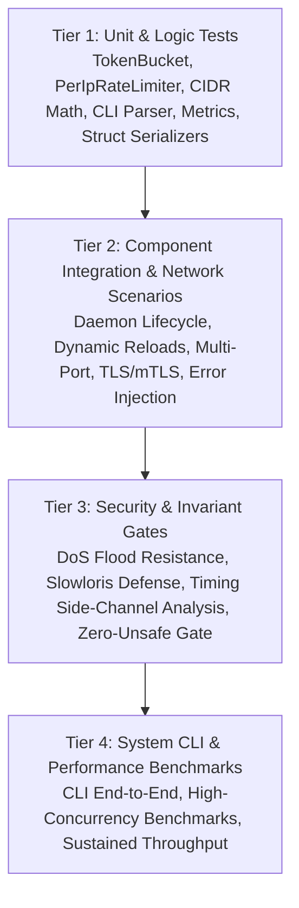

# PortProbe Enterprise Test Strategy

**Document Reference:** `PORTPROBE-QA-STRATEGY-2026`  
**Application:** PortProbe v2.0.0  
**Target Environments:** Linux (systemd / containerized Kubernetes), Windows Server (Service / Scheduled Task)  
**Author:** Senior Rust Test Engineer, QA Architect & SRE Specialist  

---

## 1. Executive Summary & Purpose

The purpose of this Test Strategy is to define the verification methodology, quality gates, test pyramids, and validation criteria applied across the PortProbe codebase. As an SRE diagnostic tool intended for mission-critical banking, government, and enterprise data center networks, PortProbe must deliver deterministic reachability verification, uncompromising memory safety, rigorous admission control, and sub-millisecond execution times.

---

## 2. Test Principles & Operational Guidelines

1. **Deterministic Execution**: Tests must not depend on internet access, external DNS resolvers, or public IP endpoints. All tests use controlled loopback (`127.0.0.1` and `[::1]`) and ephemeral dynamic port allocation.
2. **Zero False Positives / Negatives**: Probes must strictly differentiate between TCP connection success (`PORTPROBE: TCP CONNECTION SUCCESSFUL\n`), rate limiting rejections, CIDR subnet blocks, and network failures.
3. **No Flaky Concurrency**: Concurrency tests must use thread-safe synchronizers (`tokio::sync::Barrier`, `tokio::sync::watch`) rather than arbitrary `sleep` timeouts.
4. **Clean Resource Reclamation**: Every test must release sockets, background listener tasks, and temporary disk files post-execution.
5. **Strict Supply Chain Integrity**: Every third-party dependency is vetted against the RustSec Advisory Database and `cargo deny` license and ban policies.

---

## 3. Test Pyramid Architecture

PortProbe follows an enterprise four-tier test pyramid:

---

## 4. Scope of Testing

### 4.1 In Scope
- **Core Network Engine**: Single and multi-port TCP listeners, backlog tuning, non-blocking I/O.
- **TLS / mTLS Encryption**: Pure-Rust TLS 1.3 and 1.2 handshakes, X.509 certificate expiry tracking, client certificate CA validation.
- **Admission Control**: Token bucket global rate limiting, per-IP rate limiting, IPv6 `/64` routing prefix aggregation, global concurrency semaphore, per-IP connection limits, CIDR allowlists.
- **Anti-Slowloris / Resource Protection**: Default immediate slot reclamation (`hold_open = false`), 16KB payload drain cap, 4KB admin header limit, 1.0s admin read timeout.
- **Observability**: Structured JSON Lines and compact text logging, RFC 3339 local timestamps, Prometheus `/metrics` scraping, `/healthz` load balancer probes.
- **Cross-Platform Behavior**: Linux POSIX privilege dropping, dynamic `SIGHUP` reload, Windows socket hijacking protection (`SO_REUSEADDR` disabled).

### 4.2 Out of Scope
- Direct probing of public IP blocks or third-party cloud infrastructure.
- Raw kernel packet injection (raw sockets / SYN flood bypass) requiring specialized kernel modules.

---

## 5. Test Stages and Quality Gates

| Quality Gate | Stage | Enforcement Tooling | Acceptance Criteria |
| :--- | :--- | :--- | :--- |
| **Gate 1: Static Hygiene** | Stage 1 | `cargo fmt --check`, `cargo clippy --all-targets -- -D warnings` | Zero formatting diffs, 0 clippy warnings |
| **Gate 2: Unit Correctness** | Stage 1 | `cargo test --lib`, `tests/unit_tests.rs` | 100% pass (97 unit tests) |
| **Gate 3: Integration & Network** | Stage 2 | `tests/integration_tests.rs`, `tests/networking_tests.rs`, `tests/configuration_tests.rs`, `tests/cli_tests.rs` | 100% pass (31 integration tests) |
| **Gate 4: Concurrency & Stability**| Stage 3 | `tests/concurrency_tests.rs`, `tests/reliability_tests.rs`, `tests/security_tests.rs` | 100% pass under 500 concurrent connections |
| **Gate 5: Performance Benchmarks**| Stage 4 | `benches/` (`connection_benchmark`, `concurrency_benchmark`, `throughput_benchmark`) | Single conn latency < 1.0 ms, throughput > 2,000 conns/sec |
| **Gate 6: Supply Chain Security** | Stage 4 | `cargo audit`, `cargo deny check` | 0 CVEs, 0 license violations, 0 banned crates |
| **Gate 7: Security Invariant** | Stage 4 | `grep -rn "unsafe " src/` | Exactly 0 unsafe blocks |
